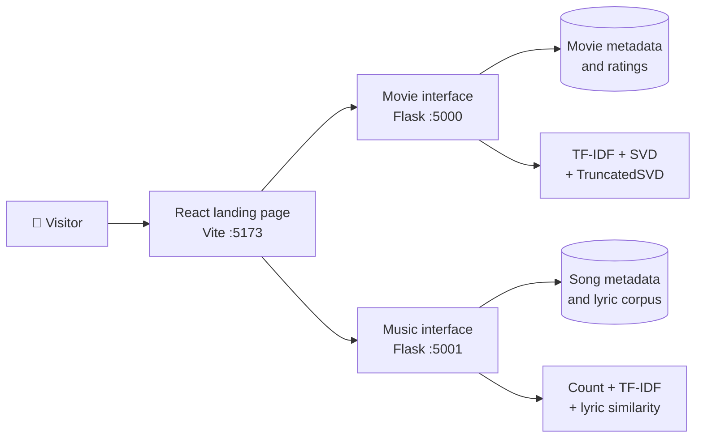
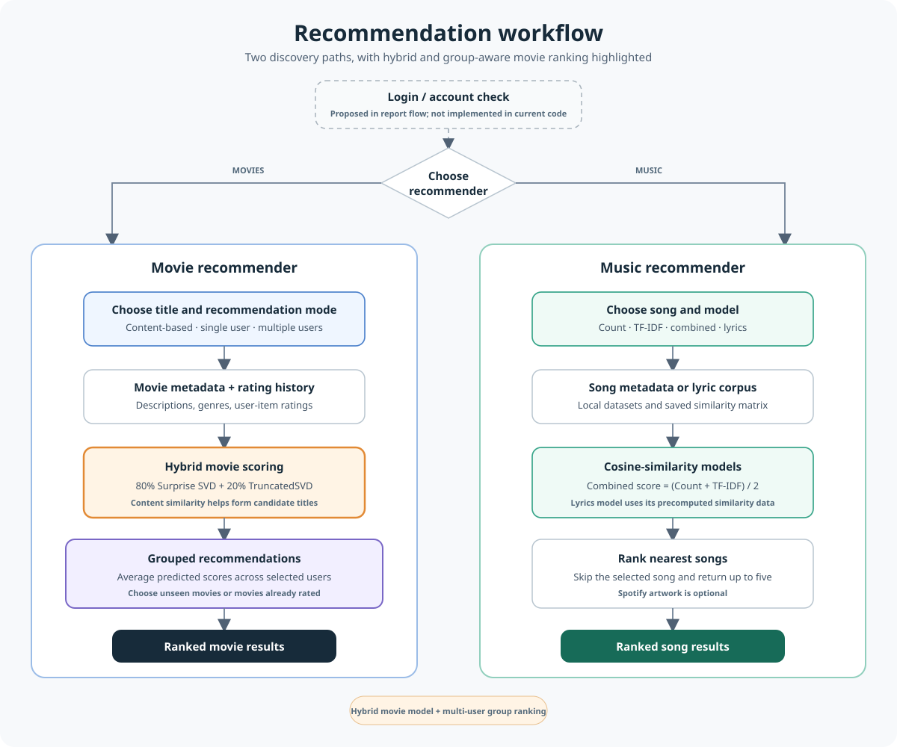
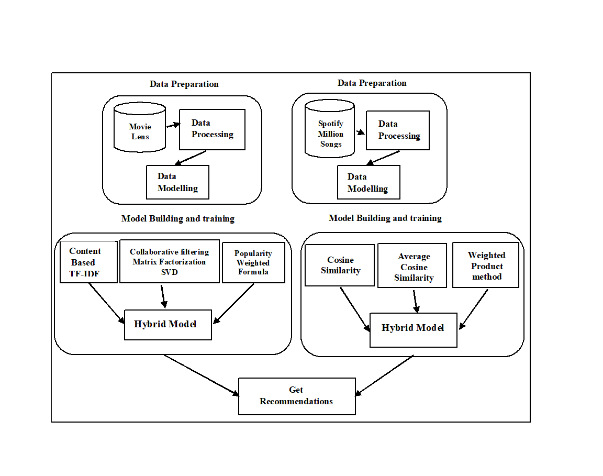
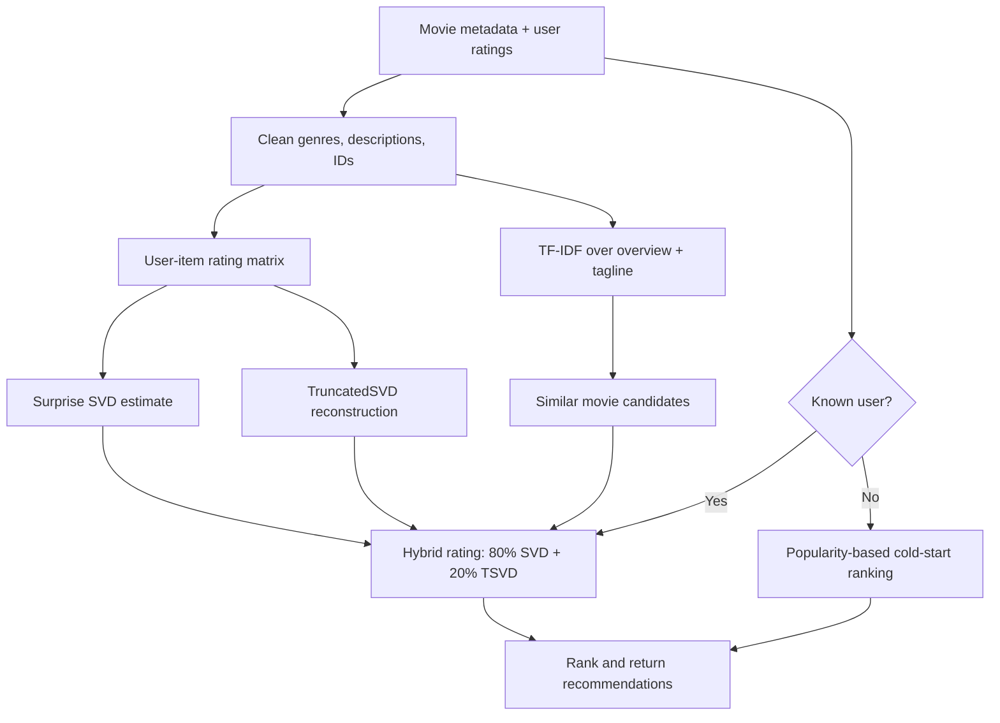
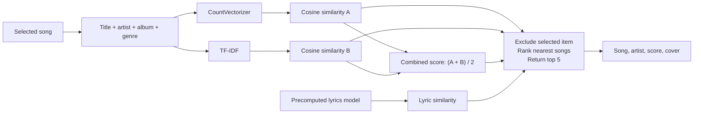
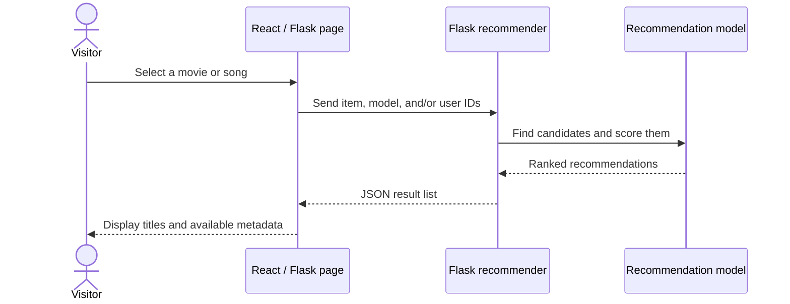

<div align="center">
# HYBRID-RECOMMENDATION-SYSTEM
# 🎬🎵 Optimizing user Preferences using Hybrid Recommendation System

### One project. Two discovery engines. Multiple ways to find your next favorite.

**Movie and music recommendations using content features, collaborative signals, and hybrid ranking.**

[](https://www.python.org/)
[](https://flask.palletsprojects.com/)
[](https://react.dev/)
[](https://vite.dev/)
[](#project-status)

**Bachelor of Technology · Computer Science & Engineering**  
**Dadi Institute of Engineering & Technology**

</div>

---

> **Project report title**  
> _Optimizing User Preferences in Recommendation Systems with a Hybrid Machine Learning Approach_

<p align="center">
  <a href="#overview">Overview</a> ·
  <a href="#how-it-works">How it works</a> ·
  <a href="#run-locally">Run locally</a> ·
  <a href="#project-team">Project team</a>
</p>

<a id="overview"></a>

## ✨ Overview

This academic project brings together two recommendation experiences in one web application:

- **Movies:** content similarity, collaborative rating prediction, and a hybrid ranking path, with popularity-based suggestions for an unknown user.
- **Music:** selectable song-similarity approaches, including CountVectorizer, TF-IDF, their combined score, and a precomputed lyrics-based model.
- **Web experience:** a React landing page links to the independent movie and music interfaces, each served by a Flask application.

The central idea is to use complementary signals. Content helps find items that resemble something a person likes; collaborative models use rating patterns across users; a hybrid can balance both rather than relying on only one view of preference.

## 🧭 At A Glance

| Area              | Implementation                  | Local address           |
| ----------------- | ------------------------------- | ----------------------- |
| Landing page      | React 18 + Vite                 | `http://localhost:5173` |
| Movie recommender | Flask + scikit-learn + Surprise | `http://localhost:5000` |
| Music recommender | Flask + pandas + scikit-learn   | `http://localhost:5001` |



## 🖼️ Architecture Figures

### End-to-end user and recommendation flow

<p align="center">
    <a href="docs/images/recommendation-workflow.svg">
        
    </a>
</p>

<p align="center"><em>Adapted from the supplied workflow figure. The login step is shown as proposed because account authentication is not implemented in the current application.</em></p>

### Data preparation, model building, and training

<p align="center">
    <a href="docs/images/model-building-architecture.png">
        
    </a>
</p>

<p align="center"><em>Original model architecture figure supplied with the project report. Click either figure to view it at full size.</em></p>

## ⭐ Standout Features

<table>
    <tr>
        <td width="50%" valign="top">
            <h3>👥 Grouped movie recommendations</h3>
            <p>Give the movie API several user IDs and it scores candidate movies for each valid user, averages those predictions, and ranks the shared list. The request can target unseen movies or titles the group has already rated.</p>
            <p><code>POST /recommend</code> with <code>type: "multi_user"</code></p>
        </td>
        <td width="50%" valign="top">
            <h3>⚖️ Hybrid movie model</h3>
            <p>For known users, the implementation blends Surprise SVD predictions (80%) with the TruncatedSVD reconstruction (20%). Content-based TF-IDF similarity helps produce related movie candidates; unknown users have a popularity-based fallback.</p>
            <p><strong>Hybrid estimate = 0.8 × SVD + 0.2 × TruncatedSVD</strong></p>
        </td>
    </tr>
    <tr>
        <td width="50%" valign="top">
            <h3>🎧 Four music model choices</h3>
            <p>Compare CountVectorizer, TF-IDF, their averaged similarity, and a separate precomputed lyrics-similarity model from the song interface.</p>
        </td>
        <td width="50%" valign="top">
            <h3>🧊 Cold-start fallback</h3>
            <p>When a supplied movie user ID has no ratings history, the service can still produce popular recommendations rather than returning an empty list.</p>
        </td>
    </tr>
</table>

<a id="how-it-works"></a>

## 🧠 How It Works

### Movie recommendation pipeline

The movie service prepares descriptions from plot overview and tagline, then uses TF-IDF and cosine similarity to find related titles. It also trains a Surprise SVD rating model and a TruncatedSVD reconstruction of the user-item rating matrix. For known users, recommendation scores combine SVD and reconstructed-matrix estimates with weights **0.8** and **0.2**, respectively. For users not present in the ratings data, the service falls back to a popularity-adjusted score based on vote counts and average ratings.



The movie API also contains single-user, multi-user, and content-based recommendation modes. Multi-user recommendations aggregate predicted ratings across the supplied user IDs and can select either new or already-seen movie candidates.

### Music recommendation pipeline

The music page allows a user to select a song and one of four models. The first three are calculated from song title, artist, album/movie, and genre tags:

| Model                   | Signal                       | What it does                                                                                 |
| ----------------------- | ---------------------------- | -------------------------------------------------------------------------------------------- |
| **1 · CountVectorizer** | Token counts                 | Builds cosine similarity from a bounded bag-of-words representation.                         |
| **2 · TF-IDF**          | Weighted token importance    | Gives less weight to terms shared by many songs, then compares vectors by cosine similarity. |
| **3 · Combined**        | Mean of models 1 and 2       | Averages the two similarity matrices to combine raw frequency and TF-IDF signals.            |
| **4 · Lyrics model**    | Precomputed lyric similarity | Uses the bundled song/artist/lyrics data and saved similarity matrix to retrieve neighbors.  |



Spotify is optional and is used only to look up album-cover artwork. Without API credentials or when Spotify cannot be reached, the music service returns a fallback cover; recommendations still use the local data and saved matrices.

### What makes the project distinctive

- **Two recommendation domains in one application:** movies and music have separate data and model pipelines, joined through a shared landing page.
- **Model comparison is user-visible:** the music interface can compare three tag-based similarity strategies and a lyrics-based alternative.
- **Hybrid movie scoring:** recommendations for known users combine collaborative predictions with a low-rank reconstruction, while a separate popularity path handles cold-start users.
- **More than one interaction pattern:** movie APIs support content-based, single-user, and multi-user requests.
- **Local-first recommendation data:** model artifacts and datasets are bundled in the project; Spotify artwork is an optional enhancement.

## 🖥️ Application Flow



> **Scope note:** the provided process sketch includes a user-login decision. The current source code does not implement account registration, authentication, or persistent per-account profiles. Movie user IDs are supplied to the recommendation interface/API; do not treat them as authenticated identities.

## 🧰 Technology

| Layer            | Tools                         |
| ---------------- | ----------------------------- |
| Frontend         | React, Vite, Tailwind CSS     |
| Backend          | Python, Flask, Flask-CORS     |
| Data handling    | pandas, NumPy                 |
| Movie models     | scikit-learn, scikit-surprise |
| Music models     | scikit-learn, joblib, pickle  |
| Optional artwork | Spotipy / Spotify Web API     |

## 📁 Project Structure

```text
project/
├── README.md
├── Requirements.txt
├── frontend/                 # React/Vite landing page
│   ├── package.json
│   └── src/
├── movie/                    # Movie datasets, server, templates, static files
│   ├── movieserver.py
│   ├── mov/                   # Alternate/older movie app implementation
│   └── datasets/
└── music/                    # Music datasets, models, server, templates
    ├── musicserver.py
    ├── datasets/
    ├── models/
    └── templates/
```

The root `music/musicserver.py` is the standalone music server and uses paths relative to its own file. Run it from the `music` directory as shown below. The movie app reads its CSV inputs relative to its working directory, so run `movieserver.py` from the `movie` directory.

<a id="run-locally"></a>

## 🚀 Run Locally

### Prerequisites

- Python 3.10 or 3.11 recommended for the versions pinned in `Requirements.txt`. The checked-in serialized scikit-learn artifacts were created with a different scikit-learn version than some environments; warnings may appear when versions differ.
- Node.js and npm for the React/Vite frontend.
- The included datasets and model files. Keep the `datasets/` and `models/` directories beside their respective services.
- Spotify credentials are optional. Set `SPOTIFY_CLIENT_ID` and `SPOTIFY_CLIENT_SECRET` only if live music artwork lookup is desired.

### 1. Install Python dependencies

From the repository root:

```powershell
python -m venv .venv
.\.venv\Scripts\Activate.ps1
python -m pip install --upgrade pip
python -m pip install -r Requirements.txt
```

If your platform cannot build `scikit-surprise` from pip, install it with Conda (`conda install -c conda-forge scikit-surprise`) and install the remaining packages from `Requirements.txt` separately. Frontend dependencies are JavaScript packages and are installed with `npm install` from `frontend/`; they are listed in `frontend/package.json`.

### 2. Start the movie service

Open a terminal in `movie/` and run:

```powershell
python movieserver.py
```

The movie service uses port **5000** by default. Its model fitting happens during startup, so the first launch can take a little while.

### 3. Start the music service

Open another terminal in `music/` and run:

```powershell
python musicserver.py
```

The music service listens on **5001**. With Spotify artwork enabled, configure credentials in the shell before launching:

```powershell
$env:SPOTIFY_CLIENT_ID = "your-client-id"
$env:SPOTIFY_CLIENT_SECRET = "your-client-secret"
python musicserver.py
```

Never commit real credentials to source control. If those variables are not set, music recommendations still work with the fallback artwork.

### 4. Start the frontend

In a third terminal:

```powershell
cd frontend
npm install
npm run dev
```

Open the URL printed by Vite, normally **http://localhost:5173**. The frontend links to the movie and music services on ports 5000 and 5001. Start those Flask services as well when using the recommendation tools.

## 🔌 API Reference

### Music service (`http://localhost:5001`)

| Method | Route                                 | Purpose                                             |
| ------ | ------------------------------------- | --------------------------------------------------- |
| `GET`  | `/`                                   | Serve the music recommender page.                   |
| `GET`  | `/songs`                              | Return songs used by the tag-based models.          |
| `GET`  | `/search?q=<text>`                    | Search song, artist, genre, and album/movie fields. |
| `GET`  | `/recommend?song=<title>&model=<1-4>` | Return up to five similar songs.                    |
| `GET`  | `/model4-songs`                       | Return songs available to the lyrics model.         |

Example:

```text
GET http://localhost:5001/recommend?song=Coca%20Cola&model=3
```

### Movie service (`http://localhost:5000`)

| Method | Route                         | Purpose                                                            |
| ------ | ----------------------------- | ------------------------------------------------------------------ |
| `GET`  | `/`                           | Serve the movie recommender page and dataset statistics.           |
| `GET`  | `/search_movies?query=<text>` | Search movie titles.                                               |
| `POST` | `/recommend`                  | Request content-based, single-user, or multi-user recommendations. |
| `GET`  | `/health`                     | Return service health status.                                      |

The movie `/recommend` request uses JSON. Select the request type with `type`:

```json
{ "type": "content_based", "movieTitle": "Toy Story", "nRecs": 10 }
```

```json
{ "type": "single_user", "userId": 1 }
```

```json
{ "type": "multi_user", "userIds": [1, 2, 3], "recommendNew": true }
```

## 🗃️ Data & Model Artifacts

- `movie/datasets/` contains movie metadata, rating records, and movie-ID links used by the movie pipeline.
- `music/datasets/ex.csv` supplies song metadata for CountVectorizer, TF-IDF, and combined models.
- `music/models/` contains vectorizers, similarity matrices, plus the saved dataframe and similarity matrix used by the lyrics model.
- `music/datasets/spotify_millsongdata.csv` is the song/lyrics corpus associated with the lyrics-model workflow.

The services currently load local files and train/load models at process startup. The recommendation flows are prototypes: they do not persist new ratings or automatically update user profiles as people interact with the site.

<a id="project-team"></a>

## 👥 Project Team

| Student                 | Roll number  |
| ----------------------- | ------------ |
| Velaga Dinesh           | `21U41A0551` |
| Gollavilli Kartik       | `21U41A05C5` |
| Koppoju Tarun Kumar     | `21U41A0524` |
| Pragada Divya Sai Kumar | `21U41A05D5` |

**Project guide:** Dr. Molli Srinivasa Rao  
**College:** Dadi Institute of Engineering & Technology  
**Degree:** Bachelor of Technology, Computer Science & Engineering  
**Academic year:** Not specified in the supplied project details  
**Report title:** _Optimizing User Preferences in Recommendation Systems with a Hybrid Machine Learning Approach_

<a id="project-status"></a>

## 🧪 Project Status & Known Limitations

- This is an academic prototype, not a production deployment. Flask's built-in development server is intended for local development only.
- Login and account management are not currently implemented, despite appearing in the supplied high-level process sketch.
- Recommendation models use the bundled datasets and artifacts; they do not learn from newly submitted feedback during a session.
- Movie SVD and TruncatedSVD models are trained at movie-server startup, which can make startup slower.
- Pretrained music artifacts may emit scikit-learn version compatibility warnings. Use compatible versions when possible, or regenerate artifacts from the training data.
- Live album artwork requires valid Spotify client credentials and network access; the recommendation result does not depend on the artwork lookup.
- Dataset licenses, complete attribution details, and final academic-year information were not present in the supplied project files/details. Add the official sources and year from the report before public distribution.

## 🔭 Future Improvements

- Add secure registration/login and a persistent preference/rating store.
- Evaluate models with held-out data and publish metrics such as RMSE, MAE, precision@K, and recall@K.
- Add model/version metadata so saved artifacts can be loaded reproducibly.
- Move long model training into an explicit training command and keep API startup lightweight.
- Add automated tests for cold-start, unknown IDs, empty search, and all four music models.
- Package the services with a shared configuration file and production-grade server/deployment setup.

## 📄 Academic Submission

**Submitted in partial fulfillment of the requirements for the award of the Bachelor of Technology degree in Computer Science & Engineering.**

**Under the esteemed guidance of Dr. Molli Srinivasa Rao**  
**Dadi Institute of Engineering & Technology**

---

<div align="center">

### Built as a student project to make discovery more personal.

🎞️ **Movies** &nbsp; · &nbsp; 🎧 **Music** &nbsp; · &nbsp; 🧠 **Hybrid ML**

</div>
